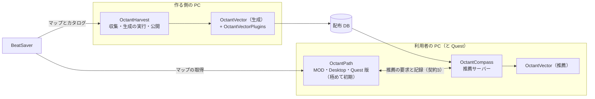

# OctantSpecs

> **To use BeatOctant** (install, known issues): [Getting Started](GettingStarted_en.md) · [はじめかた（日本語）](GettingStarted_ja.md)
>
> BeatOctant is written mostly with AI coding agents (Anthropic's Claude). The maintainer decides what to build and reviews every change. It does not generate maps; it recommends existing maps from BeatSaver. ([作り方（AI の使い方）](#作り方ai-の使い方))
>
> BeatOctant is a Beat Saber map recommender. The OctantPath mod for Beat Saber on PC and OctantPath for Quest (OctantPathAndroid, a Beat Saber Quest mod) suggest the next BeatSaver maps to play from your own play history, computed on your own PC.
>
> BeatOctant is an unofficial fan project for Beat Saber. It is not affiliated with, endorsed by, or sponsored by Beat Games or Meta. Beat Saber and Meta Quest are trademarks of their respective owners. Beat Games・Meta とは関係のない非公式の MOD・ツールです。
>
> 報告と案は [Discord の BeatOctant サーバー](https://discord.gg/gx6k3nKZBe)（バグは `#bug-reports`、案は `#feedback-ideas`）で受けます。外からの pull request は受けていません。

BeatOctant（八分儀）の仕様に関わる文書をすべて置く場所です。BeatOctant は、OctantPath、OctantPathAndroid、OctantCompass、OctantVector、OctantVectorPlugins、OctantHarvest と、この OctantSpecs をまとめた総称です（2026-10-10 決定。OctantVectorPlugins は 2026-10-14 に分け、OctantPathAndroid は 2026-10-20 に足した）。コードのリポジトリには、セットアップと使い方の説明と、ここへのリンクだけを置きます。

## 概要

BeatOctant は、Beat Saber で次に遊ぶマップを、その人のプレイの記録から推薦する仕組みです。推薦の計算は利用者の PC の中で行い、プレイの記録をどこにも送りません（[スコアの送信](contracts/external.md#スコアの送信)）。

仕組みは 2 つの流れでできていて、配布 DB でだけつながります（[憲法の原則 8](constitution.md#8-依存方向)）。

- **DB を作る流れ（作る側の PC）**: OctantHarvest が BeatSaver からマップとカタログを集め、OctantVector（と OctantVectorPlugins）で音・譜面・カバーなどを数値にし、配布 DB にまとめて公開します。配布 DB に入るのは計算した数値で、音や譜面そのものは入りません。
- **推薦する流れ（利用者の PC）**: ゲームの中の OctantPath が、プレイの記録と推薦の設定を持ち、ゲームの外の OctantCompass に推薦を頼みます。OctantCompass は配布 DB を読み、OctantVector で推薦を計算して返します。OctantPath は推薦されたマップを BeatSaver から取って入れ、自分が入れたマップだけを片付けます。

データの持ち主は 1 つずつです（[憲法の原則 7](constitution.md#7-同じ意味の正本を複数作らない)）。プレイの記録と推薦の設定の正本は OctantPath（ゲームの `UserData/OctantPath`）にあり、OctantCompass が持つのは作り直せるキャッシュだけです。

いまの段階は公開（Dev 版）で、誰でも取れる不安定版です。段階ごとに何が残っているかは [roadmap.md](roadmap.md) にあります。

## メンテナー

[nejiman10](https://github.com/nejiman10) です。文書では主語を書かず、決める・承認するなど役割の名前が要るところだけ「メンテナー」と書きます。

## 作り方（AI の使い方）

BeatOctant のコードと文書は、主に AI のコーディングエージェント（Anthropic の Claude）で書いています。隠さずに最初から書いておきます。

- **人が決めて確かめる**: 何を作るか、契約と原則を変えるかはメンテナーが決めます（[憲法の原則 9](constitution.md#9-ai-が変えてよい範囲と人間の判断が要る範囲)）。変更はすべてメンテナーが承認してから取り込みます。公開しているリポジトリは写しで、外からの PR は受けません。
- **マップは作らない**: BeatOctant は譜面を生成しません。BeatSaver にあるマップを推薦するだけで、誰がどう作ったマップかは見分けず、すべてを対象にします。音の近さには公開されている音楽のモデル（MERT など）を使いますが、何かを生成するためではなく、数値にするためです。
- **確かめていないことは書く**: 確かめていないことは「推測」と書き、決まっていないことは [open.md](open.md) に置きます。不安定版なので、バグや危なそうな動きは知らせてください。

コードの repo の README、Release の説明、告知には、英語で次の 1〜2 文を書き、この節へリンクします。

> BeatOctant is written mostly with AI coding agents (Anthropic's Claude). The maintainer decides what to build and reviews every change. It does not generate maps; it recommends existing maps from BeatSaver.

## リポジトリ

| リポジトリ | 役割 |
| --- | --- |
| [OctantPath](https://github.com/BeatOctant/OctantPath) | Beat Saber（PC）のゲーム内の MOD と、ゲームを起動せずに推薦を見る OctantPath Desktop。推薦の表示、シグナルの収集、マップのダウンロードと入れ替え |
| [OctantPathAndroid](https://github.com/BeatOctant/OctantPathAndroid) | **極めて初期で不安定。** Quest 版 Beat Saber 用の OctantPath の MOD と、ネットにつながない Quest のために BeatSaver を中継する PC のプロキシ |
| [OctantCompass](https://github.com/BeatOctant/OctantCompass) | ゲーム外で動くローカルの推薦サーバー。OctantVector を包み、ユーザーデータを持って MOD に推薦を返す |
| [OctantVector](https://github.com/BeatOctant/OctantVector) | 計算のライブラリ。ベクトル DB を書き出す計算と推薦の計算をする。OctantCompass と OctantHarvest から呼ばれる |
| [OctantVectorPlugins](https://github.com/BeatOctant/OctantVectorPlugins) | OctantVector に音や画像のモデルを使うビュー（CLAP、MERT、WavLM とその歌声版、Whisper、SigLIP）を足すプラグイン。系統ごとに 1 つのパッケージで、使うものだけ入れる |
| [OctantHarvest](https://github.com/BeatOctant/OctantHarvest) | 配布 DB を作る側のホスト。BeatSaver の定期的な収集、OctantVector での自動の埋め込み、公開 |

## 部品の版

部品は、それぞれの版で別々に出します。支えるのは、各部品の最新の版どうしの組み合わせだけです（[決まったこと](decisions.md#全体と段階)、2026-10-22）。各コードのリポジトリの README の「組み合わせる版」に、相手の部品と契約の版を書きます。契約の版は、各契約のファイルの冒頭にあります（[契約](contracts/README.md)）。

## 文書の地図

知りたいことの順に並べています。文書の頭の「固さ」の行は、その文書が先に決めて守るもの（固める核）か、実装に合わせて後から直すもの（後から記録する層）かを示します（[憲法の原則 10](constitution.md#10-段階と文書の固さ)）。

### 使う

| 文書 | 何が分かるか |
| --- | --- |
| [GettingStarted_ja.md](GettingStarted_ja.md)・[GettingStarted_en.md](GettingStarted_en.md) | 既知の問題、入れ方、ペアリング、使い方、困ったとき、やめ方。利用者向けに書き直したもの |

### 全体をつかむ

| 文書 | 何が分かるか |
| --- | --- |
| [概要](#概要)（この README） | BeatOctant が何で、部品がどうつながるか |
| [roadmap.md](roadmap.md) | 段階（いまの公開（Dev 版）→ 公開（リリース））ごとに残っていること |

### 守る決まり（固める核）

| 文書 | 何が分かるか |
| --- | --- |
| [constitution.md](constitution.md) | 憲法。推薦の対象、責務の境界、状態の正本、依存方向、部品と契約の地図、人間の判断が要る変更の範囲、段階ごとの文書の固さ |
| [contracts/external.md](contracts/external.md) | 外へ出るもの。BeatSaver などからの取得の仕方、スコアの送信 |
| [contracts/distribution.md](contracts/distribution.md) | 配布。DB を何の承認と署名で出すか（契約5） |

### 部品のあいだの取り決め（契約）

| 文書 | 何が分かるか |
| --- | --- |
| [contracts/](contracts/README.md) | 契約の決まりと一覧。境界ごとに 1 ファイルで、版はファイルごと。形の正本はスキーマ（[schemas/](contracts/schemas/)、[mod-api.openapi.yaml](contracts/mod-api.openapi.yaml)） |
| [contracts/examples/](contracts/examples/) | 契約1 推薦側（OctantCompass → OctantVector）と契約3（OctantPath ↔ OctantCompass）の JSON の例。OctantPath と OctantCompass のテストが読む |

### 部品の中

各部品の実装が守る意味（法）と、仕組みの説明です。文書に出てくるファイル名は、その部品のリポジトリのコードのものです。

| 文書 | 何が分かるか |
| --- | --- |
| [octantpath/law.md](octantpath/law.md) | OctantPath 法。識別、取得と設置、所有と削除、プレイの観測、ユーザーのデータ |
| [octantcompass/law.md](octantcompass/law.md) | OctantCompass 法。守る境界、履歴と session context、起動と終了、管理画面、ペアリング、DB の更新 |
| [octantvector/law.md](octantvector/law.md) | OctantVector 法。識別、版、検索、好意の判定、構成 |
| [plans/recommendation-definition.md](plans/recommendation-definition.md) | 推薦の定義。OctantVector が何を推薦し何を返すか（Q1〜Q8） |
| [plans/presets.md](plans/presets.md) | 手札（プリセット）。OctantPath の推薦のボタンを、OctantCompass が開示する手札の一覧から作る仕組み |
| [plans/difficulty-fit.md](plans/difficulty-fit.md) | 推薦する譜面の難易度をユーザーに合わせる仕組み（得意な譜面からの距離、セッション序盤の調整） |
| [plans/personal-data-overfitting.md](plans/personal-data-overfitting.md) | 1 人分の教師データで過学習しないための方針（ほぼ未実装） |
| [plans/octantpath-implementation.md](plans/octantpath-implementation.md) | OctantPath の作り。既存のマップとの区別、ミックスの今の形、リスク |
| [octantvector/design.md](octantvector/design.md) | OctantVector の作り（パッケージの構成、台帳と値の版、マルチエンコーダ、配布物、推薦） |
| [octantvector/encoders.md](octantvector/encoders.md) | エンコーダとプラグインのビューの一覧、既知の問題、プラグインの入口 `octantvector.plugin`（不安定版） |
| [octantvector/swing.md](octantvector/swing.md) | スイングシミュレーション（難易度・プレイスタイル） |
| [octantvector/config.md](octantvector/config.md) | OctantVector の設定の読み込みの順（値は OctantVector のコード） |
| [octantvector/experiments.md](octantvector/experiments.md) | 実験の結論と、そこから決めた既定値 |
| [octantharvest/config.md](octantharvest/config.md) | OctantHarvest の設定で決まっていること（値は OctantHarvest のコード） |

`plans/` の文書は、はじめ計画として書き、いまは実装済みの仕組みの説明になっています。コードが節の番号とパスで指しているので、場所と名前は変えていません。

### 決まったこと・やめたこと・決まっていないこと

| 文書 | 何が分かるか |
| --- | --- |
| [decisions.md](decisions.md) | 決まったことの記録。いつ、何を、なぜ決めたか |
| [decisions.md の「やめたこと・置き換えたこと」](decisions.md#やめたこと置き換えたこと) | やめた仕組みや決まりと、その理由と代わり |
| [open.md](open.md) | 未決点と、メンテナーの判断を待つ食い違いの一覧 |

### 直す

| 文書 | 何が分かるか |
| --- | --- |
| [CONTRIBUTING.md](CONTRIBUTING.md) | OctantSpecs を直すときの決まり。決まった・未決が出た・やめた・食い違ったときに、どこへ何を書くか |

## ライセンス

文書は [CC BY 4.0](LICENSE) です。各リポジトリのコードは MIT、配布 DB は CC BY-NC-SA 4.0 です（2026-10-12）。

BeatOctant は非営利です。寄付は受け付けますが、特典は支援者の名前の掲載までにし、機能や推薦の中身と結びつけません（2026-10-12。理由は [decisions.md](decisions.md#全体と段階)）。

配布 DB の利用条件の NC は `mert_v1_95m`（CC BY-NC 4.0）と非営利の決定から、SA は MusicBrainz のタグと評価（CC BY-NC-SA 3.0）を DB に入れると同じ条件を継ぐことからきます。README に書くクレジットは次のとおりです。

- CLAP（Apache-2.0）
- MERT-v1-95M（CC BY-NC 4.0）
- BeatLeader の analyzer（MIT）
- BeatSaver（マップの出所）
- MusicBrainz（中核データは CC0、タグと評価は CC BY-NC-SA 3.0）
- ListenBrainz（似たアーティストのデータは CC0。2026-10-17 確認、[decisions.md](decisions.md#近いアーティスト)）

DB の中では、DB 全体の利用条件（OctantHarvest の `DB-NOTICE.md`）がマニフェストの `notice` に、各ビューのクレジットがビューの `credits` に入ります（[契約2](contracts/vector-db.md#マニフェストの例)）。OctantCompass の詳細設定で読めます。
