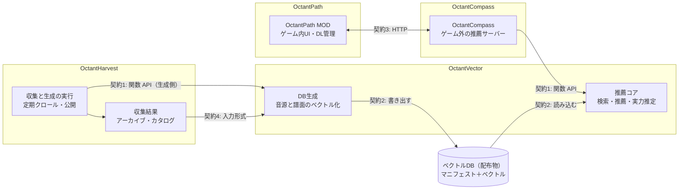

# BeatOctant 憲法

> 固さ: 原則 1〜8（4b を含む）は固める核で、変えるにはメンテナーの判断が要ります（原則 9）。正本: この文書。

2026-10-04 作成（2026-10-05 OctantHarvest を追加。2026-10-06 ユーザー状態の正本を OctantPath に移す。2026-10-09 部品と契約の地図を契約から移す。2026-10-10 原則 10 を足す。推薦の設定の意味を書く。手札の定義を配布 DB に移す。手札の元のファイルの正本を OctantHarvest に置く。2026-10-12 公開（Dev 版）を招待制と決める。2026-10-21 公開（Dev 版）を誰でも取れる不安定版にし、束で出す。2026-10-22 束をやめ、部品ごとの版で出す。2026-10-22 公開（Dev 版）の準備に入ったことを書く。2026-10-24 段階を公開（Dev 版）に上げる）

## この文書の役割

実装は AI に任せ、境界だけを人間が握る。この文書は、人間が握る境界だけを書く。

- 書くもの: 何を推薦対象とみなすか、各コンポーネントの責務、状態の正本、依存方向、人間の判断が要る変更の範囲。
- 書かないもの: アルゴリズム、検索の順序、index、cache、schema、名前、型など。ここに書かれていないことは実装詳細とみなす。
- コンポーネント間の取り決めの具体的な形は、[contracts/](contracts/README.md)（以下「契約」）が定める。どの境界にどの契約があるかは、この文書の[部品と契約の地図](#部品と契約の地図)に書く。
- 評価・実験・benchmark・migration などの開発補助ツールは、原則 3〜8（4b を含む）の境界を変えない限り、この文書の対象外とする。Spike の置き場での扱いは[原則 10](#10-段階と文書の固さ)に書く。

---

## 1. 推薦の対象は Chart

ユーザーが実際に遊ぶのは Chart である。推薦結果の各項目は、最終的に特定の Chart を指せなければならない。

同じ Map に属する Chart も、characteristic、difficulty、gameplay style、rhythm、movement、tech 傾向などが異なる別のプレイ対象として扱える。推薦の評価には、Chart 固有の情報を使えなければならない。

内部で Map 単位の index や候補探索を使うこと、1 Map あたりの候補数を制限することは、この原則に反しない。

## 2. 情報の粒度を失わない

同じ Map の複数の Chart が共有する情報（sound、audio、楽曲の metadata など）と、Chart 固有の情報がある。観測した signal も同じで、play は Chart 単位で観測し、Favorite や Vote のように Map 単位でしか観測できないものは Map 単位で持つ。

情報も signal も、どの粒度で観測されたかを失わない。Chart identity と版の違いを曖昧に潰さない。

各 Chart が、どのプレイスタイル（Standard、OneSaber、FeetSaber など）で遊ぶものかを区別して扱う。プレイスタイルが違えば、特徴の計算方法も、ユーザーの得意・不得意も違い得る。プレイスタイルの区別を潰して、別のプレイスタイルの特徴やプレイ記録を同じものとして比べない。どのプレイスタイルどうしを比べられるか、プレイスタイルごとに特徴をどう計算するかは OctantVector の計算と実験に任せる。プレイスタイルの表し方は契約で決める。

粒度で用途を固定しない。Map 単位の情報も Chart 固有の情報も、好みと難しさのどちらに使ってもよい。両者をどう組み合わせて Chart を評価するかは、OctantVector の計算に任せる。identity の具体的な表し方は契約で決める。

## 3. OctantVector は表現と計算を担う

OctantVector は、特徴表現、vector、distance、similarity、Profile、Skill、候補の評価を計算する。配布 DB を書き出す計算と、読み込む計算を持つ。OctantVector はライブラリで、いつ何を計算するかは呼ぶ側（推薦では OctantCompass、生成では OctantHarvest）が決める。OctantVector は通信しない。

推薦の手札（embedding の扱い方 1 つと、そのつまみに名前を付けたもの）を配布 DB から読み、その DB で使えるかを確かめ、条件に展開するのも OctantVector である。扱い方の中身は OctantVector のコードに置き、DB には書かない（2026-10-10）。

OctantVector は、永続的なユーザー状態と Beat Saber の実行状態の正本を持たない。必要な情報は入力として受け取る。既定値や個人化の結果を、計算結果として返してよい。

## 4. OctantCompass は要求を統合するホスト

OctantCompass は、OctantPath から要求を受け、OctantVector を呼んで推薦を返すホストである。ユーザー状態の正本は持たない。OctantPath から受け取った履歴と設定を、つないできた OctantPath の環境ごとに分けてキャッシュとして持ち、session context はそこから作る。キャッシュは失っても OctantPath から受け取り直して作り直せる。異なる環境のキャッシュを混ぜない。

1 つの OctantCompass に、複数の OctantPath の環境（別の Beat Saber のインストールやプロファイル、別の端末）がつながってよい。OctantCompass は、つないでよい環境を自分で管理する。

推薦要求の条件は、複数の出所から来てよい。

- OctantPath から来る、ユーザーが明示した条件、ゲーム側の事実、履歴、推薦の設定
- OctantCompass がキャッシュから作る session context
- OctantVector が返す既定値と個人化の結果

OctantCompass の役割は、これらを統合して OctantVector を呼ぶことである。すべての条件を OctantCompass が自分で決める必要はない。

OctantCompass は、distance、similarity、Skill など OctantVector の計算を再実装しない。OctantVector の結果を同じ特徴量で評価し直す、第二の評価器を作らない。

OctantCompass は、Beat Saber のプロセス内の実装（ゲームの class、Zenject の object、Harmony の hook、MOD の内部 API）に依存しない。ゲームのフォルダのファイルも読まない（OctantPath と同じ端末で動くとは限らないため）。

## 4b. OctantHarvest は配布 DB を作る側のホスト

OctantHarvest は、OctantVector をエンコーダとして使い、配布 DB を作って公開するホストである。OctantCompass が推薦のために OctantVector を包むのと対になる。

OctantHarvest は、BeatSaver などの外部データの定期的な収集（Map の zip とカタログ）、収集した入力での OctantVector の生成の呼び出し（自動の embedding）、その実行の予定と記録、公開の承認と配布物の置き場所を担当する。

OctantHarvest は、vector、distance、similarity、校正など OctantVector の計算を再実装しない。配布 DB の形式を自分で組み立てない。

OctantHarvest は利用者の PC で動く部品ではなく、ユーザー状態を持たない。OctantCompass と OctantPath を呼ばず、呼ばれもしない。

## 5. OctantPath は Beat Saber 側とユーザー状態を担う

OctantPath は、ゲーム内の観測、UI とユーザー操作、Map の download と install、SongCore、playlist、自分が取得した Map の所有管理と安全な削除を担当する。

OctantPath は、自分が動く環境（Beat Saber のインストールやプロファイル）ごとに、ユーザーの signal、play history、推薦の設定の正本を持ち、OctantCompass に渡す。OctantPath 導入前の履歴（PlayerData、`votedSongs.json`、ScoreSaber や BeatLeader のローカル記録など）の取り込みも OctantPath が担当する。

推薦の設定とは、ユーザーが推薦をどう受け取るかを選んで変える値のことである。OctantCompass は、使える推薦の条件の組み合わせ（手札）を OctantPath に渡す。OctantPath は手札を種類ごとに場所を分けてユーザーに見せ、ユーザーは 1 枚を選び、要る入力（キー）と一緒に返す。どの手札をどこに出すか・出さないか・どの順に並べるか、件数、推薦の数値が推薦の設定で、OctantPath にある。手札の一覧と、各手札の中の条件は推薦の設定ではない。手札は配布 DB に入れて配り、OctantVector が読んで、その DB と OctantVector で使える手札だけを返す。DB に手札がなければ OctantVector の既定の手札を使う。OctantCompass は手札を中継し、中身を組まない（2026-10-10）。

OctantPath は、OctantPath だけが知るゲーム側の事実（導入済み、取得失敗、利用不能など）を、推薦要求の条件として OctantCompass に伝えてよい。事実を伝えることは推薦の方針ではない。

## 6. OctantPath は第二の推薦評価器にならない

OctantPath は、Profile、Skill、推薦 score、signal から、独自の推薦 score を作らない。受け取った推薦結果を、推薦の方針として並べ替えない。

次のことは許される。

- Beat Saber 標準の sort
- ユーザーが明示的に選んだ sort と filter
- UI 上の表示順の変更
- 実行できないものを外す、または unavailable と表示すること
- ゲーム側の資産管理（取得した Map を残すか消すかの判断を含む）

区別の基準は、それが表示や実行可能性の処理なのか、推薦の順位付けを変える方針なのかである。推薦側が返した順位（Recommended 順）は、表示の sort で書き換えずに残す。

## 7. 同じ意味の正本を複数作らない

| 持ち主 | 正本 |
| --- | --- |
| OctantPath | 環境ごとの、ユーザーの signal、play history（取り込んだ導入前の履歴を含む）、推薦に使うユーザー設定、ゲーム内の動作設定。自分が取得した Map の所有と download・install の状態、playlist などゲーム側との対応。つなぐ OctantCompass の接続情報 |
| OctantCompass | 自分の動作設定（DB の置き場所、待ち受けなど）、つないでよい OctantPath の環境の一覧。ユーザー状態はキャッシュだけ |
| OctantVector | ユーザー状態の正本は持たない。生成の台帳（どの入力をどのエンコーダで計算したか）と作業用の保存先を持つ。置き場所は呼ぶ側が渡す |
| OctantHarvest | 収集した外部データ（Map の zip、カタログ、収集の記録）、公開の承認、生成の実行の記録。公式の配布 DB に入れる手札の元のファイル（2026-10-10） |

同じ意味の正本を 2 か所に作らない。cache、ledger、派生カウンタは正本の複製ではないので、許される。OctantCompass が環境ごとに持つ履歴と設定、そこから作る session context も、OctantPath の正本から作り直せるキャッシュである。Profile と Skill は、正本から作り直せる派生物として扱う。

## 8. 依存方向

実行時の依存は OctantPath → OctantCompass → OctantVector の向きだけとする。OctantPath は OctantVector を直接呼ばない。OctantVector は OctantCompass と OctantPath を呼ばない。

配布 DB は別系統で、外部データ → OctantHarvest の収集 → OctantVector の生成（OctantHarvest が呼ぶ）→ 配布 DB → OctantVector の読み込み（OctantCompass が呼ぶ）、と流れる。生成時の依存は OctantHarvest → OctantVector の向きだけとする。OctantVector は OctantHarvest を呼ばない。2 つの系統は配布 DB（契約）でだけつながる。

## 部品と契約の地図

OctantVector は計算のライブラリ（DB 生成と推薦のコア）、OctantCompass は推薦側の OctantVector を包んで結果を MOD に返すゲーム外の推薦サーバー、OctantHarvest は生成側の OctantVector を包んで外部データを集め配布 DB を作るホスト、OctantPath はゲーム内の MOD です（OctantCompass を OctantPath から別リポジトリに分けたのは 2026-10-03、OctantHarvest を足したのは 2026-10-05 の決定）。部品やプロセスの境界には次の契約があり、ほかにこちらでは決められない外部依存があります（[契約の外部依存](contracts/external.md)）。

| # | 契約 | 境界 | 実装する側 |
| --- | --- | --- | --- |
| 1 | [OctantVector の関数 API（推薦側）](contracts/engine-runtime.md)、[（生成側）](contracts/engine-generation.md) | OctantCompass → OctantVector（推薦側）、OctantHarvest → OctantVector（生成側） | OctantVector |
| 2 | [ベクトルDB形式](contracts/vector-db.md) | DB生成 ↔ 推薦コア（配布物） | OctantVector |
| 3 | [MOD ↔ OctantCompass API](contracts/mod-api.md) | ゲーム内の MOD ↔ ゲーム外の OctantCompass | OctantPath と OctantCompass |
| 4 | [生成の入力形式](contracts/generation-input.md) | OctantHarvest の収集結果 ↔ OctantVector の生成 | OctantHarvest（書く）と OctantVector（読む） |
| 5 | [DBの配布と更新](contracts/distribution.md) | OctantHarvest（公開）↔ 配布先 ↔ OctantCompass | OctantVector（索引の形と読み方）と OctantHarvest（置き場所と承認） |
| 6 | [見つけ方と接続](contracts/launch.md) | つなぐ側 ↔ OctantCompass | OctantPath と OctantCompass |

図はデータが流れる契約1（OctantCompass・OctantHarvest → OctantVector）・契約2（DB 生成 ↔ 推薦コア）・契約3（OctantPath ↔ OctantCompass）・契約4（OctantHarvest の収集結果 → OctantVector）を示します。OctantCompass と OctantHarvest が OctantVector について知るのは契約1だけで、DB の中身は OctantVector の中で閉じます。

OctantCompass と OctantVector の責任は、次のように分かれます（原則 3・4・7 の具体化）。

| 対象 | OctantVector | OctantCompass |
| --- | --- | --- |
| ベクトルDB | 検証、読み込み、更新の計画と差分の適用 | 置き場所の管理、索引と配布物のダウンロード |
| ユーザーデータ | 持たない（毎回引数で受け取る） | OctantPath から受け取った履歴と設定を、環境ごとにキャッシュする。正本は OctantPath（原則 4・5・7） |
| 推薦 | 好みと実力の推定、候補の評価と順位、理由。好意の判定（[OctantVector 法](octantvector/law.md) 4.1）もこちらで守る | 手札と条件をまとめて呼ぶ（手札の中身は見ない）。難易度の狙いを選ぶ。結果を順位を変えずに返す |
| 通信 | しない | MOD との HTTP、配布先からのダウンロード |

## 9. AI が変えてよい範囲と、人間の判断が要る範囲

AI は、コンポーネント内部の実装詳細を自由に変えてよい。この文書に書かれていないものは、すべて実装詳細である。

次の変更には人間の判断が要る。

- **契約の変更**: [部品と契約の地図](#部品と契約の地図)の契約（外部契約）の変更と、契約を足すこと・なくすこと。[契約の決まり](contracts/README.md#契約の決まり)に従う。
- **原則 1〜8（4b を含む）を変える変更**: 推薦対象、情報の粒度、責務、正本、依存方向を変えるもの。

実装の都合で境界を越える必要が出たら、実装を先に進めない。どの原則が問題か、何が実装困難か、最小限どの境界を変えたいか、境界を保つ代替案は何かを示し、人間に判断を求める。実装が先にあることは、境界を変える理由にならない。

## 10. 段階と文書の固さ

（2026-10-10 決定。案の「二層にする」）

BeatOctant の段階は「非公開（探求中）」→「公開（Dev 版）」→「公開（リリース）」で、今は公開（Dev 版）である（2026-10-24。2026-10-10 から 2026-10-24 までは非公開（探求中））。公開（Dev 版）は誰でも取れる不安定版で、壊れてよい（2026-10-21。2026-10-12 の「招待した数人に向けた版」を置き換える）。ソースの写し・実行ファイル・DB は GitHub の Organization に public で置く（2026-10-17）。公開（リリース）は誰でも入れられる版である（2026-10-12）。公開（リリース）の前（非公開（探求中）と公開（Dev 版））は PoC と Prototype を行き来するので、文書を先に固めると検証が遅くなる。公開（リリース）の前は、文書を「固める核」と「後から記録する層」に分ける。

| | 中身 | 公開（リリース）の前の扱い |
| --- | --- | --- |
| 固める核 | この憲法の原則 1〜8（4b を含む）。外へ出るもの（配布、BeatSaver などへの取得の仕方、スコアの送信）。開発用の PC にあるプレイの記録を壊さないこと | 先に決める。本線の実装と食い違ったら、実装を直さず報告する（原則 9 のとおり） |
| 後から記録する層 | 契約の形（[contracts/](contracts/README.md)、スキーマ、例）、計画（`plans/`）、各部品の法と実装契約、画面 | 本線の実装が先でよい。食い違いは報告で止めず、実装に合わせて OctantSpecs を直す PR を後から出す。まとめて 1 つの PR にしてよい |

- **契約の手続き。** 公開（リリース）の前は、契約の形を変える実装の PR を先に出してよい。OctantSpecs の契約、スキーマ、例は後から合わせる。公開（Dev 版）は自動の更新をせず、各部品の最新の版どうしの組み合わせだけを支えるので（下の「公開（Dev 版）の出し方」。[契約5（OctantHarvest → 配布先 → OctantCompass）の非公開と Dev 版の扱い](contracts/distribution.md#非公開探求中の扱い)）、形の変更は版を上げずに「版ごとの変更」に 1 行書くだけでよい（推測で安全と見ている。版の番号を使い直さない決まりは守る）
- **Spike の置き場。** 各リポジトリの `spikes/`（OctantPath は今の `probes/` も同じ扱い）に置いたコードは、ほかのリポジトリの内部を読んでも import してもよく、原則 3〜8 に縛られない。本線のコードと配布物は `spikes/` に依存しない。結果と結論は OctantSpecs か共有のメモに書き、本線に入れるときは後から記録する層の手続きで入れる。外へ出るものと、開発用の PC にある記録を壊さないことは、Spike でも守る
- **公開（Dev 版）の出し方。** MOD・OctantCompass・OctantPath Desktop・DB はそれぞれの版で出し、各部品の最新の版どうしの組み合わせだけを支える（2026-10-22。2026-10-21 の「同じ日付の束」を置き換える）。自動の更新はしない。そのため Dev 版に上げても、部品の間の契約は後から記録する層のままでよい。利用者に約束するのは「OctantPath のプレイの記録を黙って消さない」だけで、記録の形を変えるときはその版の説明に先に書き、作り直す（移行のコードはプロダクトに入れない）。DB と各部品の設定・キャッシュは、版を上げるたびに入れ直しになってよい（2026-10-21）
- **固める時期。** 次のどれかで、その部分を「先に決める」に戻す。(1) 段階を公開（リリース）に上げるとき。(2) 2 つの部品を別々の作業（別のセッションや別の人）で同時に作るとき（例: OctantCompass 実装契約（2026-10-17 に退役）のように、相手の実装を見ずに作る依頼）。(3) 形を変えると、すでに開発用の PC にある記録や DB が読めなくなるとき
- 段階を上げるのはコードの変更と同じくメンテナーが承認する PR で行う。
